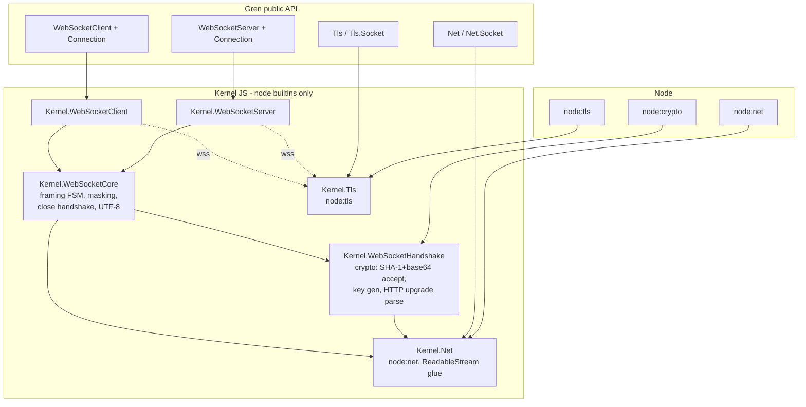

# Plan: Native WebSocket + Net + TLS for gren-lang/node

Status: proposal. Supersedes the npm-`ws`-based implementation in `dae5caf`.
References: RFC 6455 (WebSocket), RFC 6455 §5 (framing), Autobahn TestSuite
(<https://websocket.org/guides/testing/autobahn>).

## 1. Context and problem

`src/Gren/Kernel/WebSocketClient.js` and `src/Gren/Kernel/WebSocketServer.js` both
do `require("ws")` (client :14, server :13). A `gren-lang/node` core-library
kernel may only use Node built-ins — the repo's own precedent is
`require("node:http")`, `require("node:fs")`, etc. `ws` in a published package
breaks every consumer (no `node_modules`, no install step). It must be replaced.

What `ws` is currently used for (this is the complete feature surface to
reimplement — nothing beyond this is used):

| ws feature                                                                    | Where used                               |
| ----------------------------------------------------------------------------- | ---------------------------------------- |
| Client `new WebSocket(url)` + `open`/`message`/`close`/`error` events         | `Kernel/WebSocketClient.js` connect      |
| Server `new WebSocket.Server({host,port})` + `listening`/`error`/`connection` | `Kernel/WebSocketServer.js` createServer |
| per-socket `send(data, cb)` (text + binary)                                   | send / sendBytes / writable              |
| `close(code, reason)` + close-event `(code, reason)`                          | close, onClose subs                      |
| `client._socket.pause()/resume()`                                             | backpressure via `CountQueuingStrategy`  |
| HTTP Upgrade handshake, masking, fragmentation, ping/pong, UTF-8 validation   | (implicit — all inside ws today)         |

Everything else in the public Gren API (`WebSocketClient`, `WebSocketClient.Connection`,
`WebSocketServer`, `WebSocketServer.Connection`) stays **byte-for-byte compatible**.
App code does not change; `integration-tests/websocket/` must pass unchanged
(it may keep using `ws` as a _test-only_ dev dependency — that is allowed,
test harnesses are not shipped code).

## 2. Decisions and rationale

**D1 — `Net` and `Tls` become first-class exposed modules.** `node:net` (TCP)
and `node:tls` get public Gren modules so WebSocket is built on them _and_
third-party libraries (raw TCP servers, custom protocols, database drivers)
can too. This avoids the `ws`-shaped hole where a private socket layer
accretes undocumented in kernel code.

**D2 — WebSocket framing lives in kernel JS, not pure Gren.**
Tempting alternative: parse frames in Gren with `Bytes.Decode` + `Bitwise`
(both exist in core 7: `unsignedInt8/16/32`, `and/or/xor/shiftLeftBy/...`).
Rejection reasons:

- The handshake cannot be pure Gren anyway: `Crypto.digest` in core 7.0.0
  supports only Sha256/384/512 — **no SHA-1**, which RFC 6455 §1.3 mandates for
  `Sec-WebSocket-Accept` — and there is no base64 codec. Both are one-liners in
  kernel JS via `node:crypto` (`createHash("sha1")`, `randomBytes`,
  `Buffer.toString("base64")`). So a kernel component is required regardless.
- Frame hot path (mask XOR over every payload byte, per-frame header decode) is
  allocation-heavy in pure Gren; the repo pattern (HttpClient/HttpServer/FileSystem)
  is "mechanism in kernel, semantics in Gren".
- Backpressure today works because kernel closures hold the raw socket handle
  and call `_socket.pause()/resume()` tied to the `ReadableStream` controller's
  `desiredSize` (`WebSocketServer.js:62-120`, `WebSocketClient.js:37-49`).
  Driving that through a Gren-level `Net.Socket` API would need pause/resume
  hooks leaking into the public Stream API anyway.
- UTF-8 validation for text frames needs fatal decoding on _Bytes_ (autobahn
  6.5.x/6.6.x close-code-1007 behavior). `Bytes.toString` is already fatal-Maybe
  (`TextDecoder("utf-8",{fatal:true})` in core kernel), but doing it in the frame
  parser avoids a double copy.

So: `Net`/`Tls` are exposed _for users_; WebSocket consumes their **kernel
internals** (`Gren.Kernel.Net` / `Gren.Kernel.Tls`), exactly like
`WebSocketServer.gren` already reaches into `Gren.Kernel.WebSocketServer`.
If/when pure-Gren framing becomes desirable, the frame codec can be factored
into a separate package against the public `Net` API — that is an additive
change, not a re-architecture.

**D3 — SHA-1 stays in the kernel, not added to core.** SHA-1 here is
interoperability-mandated, not a security choice; adding `Sha1` to
`Crypto.DigestAlgorithm` (gren-lang/core) is a separate upstream proposal and
MUST NOT block this work. Note it as a follow-up issue so future pure-Gren
code isn't forced into kernel hacks.

**D4 — No extensions in v1 (no `permessage-deflate`).** The public `Option`
type currently has exactly one constructor (`ReadBufferCapacity`), so nothing is
dropped. Autobahn `permessage-deflate.*` cases are excluded in v1 (see §6.5).
`Stream.gzipCompression` etc. exist in core but permessage-deflate needs
shared-context streaming (`server_no_context_takeover` etc.) — real work,
defer (F1 in §8).

**D5 — One shared kernel protocol core.** Client and server share
framing/handshake/close logic in `src/Gren/Kernel/WebSocketCore.js`
(private kernel module; not exposed in `gren.json`). The only asymmetries:
masking direction (client→server masked, server→client unmasked — RFC 6455 §5.1),
handshake request vs response, and TLS/SNI client options.

## 3. Architecture



Layering rule enforced in review: `Kernel.WebSocketCore` may call
`_Net_*`/`_Tls_*` functions and `node:crypto`/`node:net`/`node:tls` — it may
NOT `require` anything else. `Net.gren`/`Tls.gren` are normal public modules
listed in `gren.json` `exposed-modules`.

## 4. Module designs

### 4.1 `Net` / `Net.Socket` (new)

Mirrors the repo's established shape (`HttpServer`, `FileSystem`): permission
gate, `Task`-returning constructors, `Stream.Readable`/`Stream.Writable`,
opaque error with `errorCode`/`errorIs*` predicates (same style as
`WebSocketServer.Connection.Error`).

```gren
module Net exposing
    ( Permission, initialize
    , Socket, socketId, connect
    , Listener, listen, onClose          -- (onConnection lives here, see below)
    , Option(..)                        -- KeepAlive, NoDelay, ReadBufferCapacity, AllowHalfOpen
    , NetError(..)
    )

-- Net.Socket
readable  : Socket -> Readable Bytes      -- chunks of received data
write     : Socket -> Bytes -> Task Error {}
close     : Socket -> Task Error {}       -- half-close semantics: FIN, keep reading? -> Option EndOnClose
end       : Socket -> Task Error {}       -- half-close (socket.end())
-- error predicates: errorIsConnectionRefused, errorIsTimeout, errorIsReset, errorIsBrokenPipe

onConnection : Listener -> (Socket -> msg) -> Sub msg   -- Net effect module
onClose      : Listener -> (Socket -> msg) -> Sub msg
```

Kernel facts: `node:net.Socket` → `ReadableStream` glue copied from the current
WebSocket kernels (controller + `desiredSize`-driven `pause()`/`pull`→`resume()`);
`WritableStream` `write` resolves on the `socket.write(buf, cb)` callback
(same as `WebSocketClient.js:54-89`). DataView↔Buffer conversion uses the
existing `new DataView(b.buffer, b.byteOffset, b.byteLength)` /
`Buffer.from(bytes.buffer, bytes.byteOffset, bytes.byteLength)` pattern.

`connect` takes `{ host, port_, options }` and resolves once the socket is
connected (`socket.on("connect")`), fails with `NetError { code, message }`
(surface `ECONNREFUSED`, `EHOSTUNREACH`, timeouts). `listen` resolves on
`listening`. Address reuse (`EADDRINUSE`) surfaces as code string, matching
`HttpServer.ServerError` precedent.

### 4.2 `Tls` / `Tls.Socket` (new)

```gren
module Tls exposing
    ( Permission, initialize
    , Socket, connect            -- client, over its own TCP connection
    , secure                     -- upgrade an existing Net.Socket
    , Listener, listen           -- TLS server
    , ClientOption(..)           -- Ca CertificateBytes, ClientCert KeyBytes, ClientKey KeyBytes,
                                 -- RejectUnauthorized Bool, ServerName String, AlpnProtocols (Array String)
    , ServerOption(..)           -- Cert KeyBytes, Key KeyBytes, Ca CertificateBytes, RequestClientCert Bool, AlpnProtocols ...
    , TlsError(..)               -- handshake failures keep node's code+message (e.g. ERR_TLS_CERT_ALTNAME_INVALID, SELF_SIGNED_CERT)
    )
```

Kernel: `node:tls.connect({ socket: netSocket, ... })` (client upgrade) and
`tls.createServer`/`tls.connect` server-side via `server.socket` when `Net.listen`
is TLS-wrapped; `Tls.Socket` exposes the same `readable`/`write`/`close` shape as
`Net.Socket` (`pause/resume` on a TLS socket flows to the underlying socket —
same backpressure design holds). `secure : Net.Socket -> ... -> Task TlsError Tls.Socket`
is what `wss://` uses, and is also the generic STARTTLS-style building block
other libraries need.

Certificates are bytes (PEM) so tests can read fixtures via `FileSystem` — no
filesystem coupling inside the kernel. `rejectUnauthorized` defaults `True`
(`ws`' `insecure` equivalent is `RejectUnauthorized False`, explicitly
opt-in; document the foot-gun).

### 4.3 `WebSocketCore` (kernel, new — the RFC 6455 engine)

A hand-rolled state machine over the inbound byte stream, per
`WebSocketServer.js` `_ensureListenersAttached` slot today:

- **Ingest**: bytes from `_Net_*` data events → FSM
  `Opcode → Len7 → Len16/64 → MaskKey → Payload → (emit message)`.
- **Validation table** (all produce protocol-error → close codes; each is a
  named kernel function so autobahn failures map to it):
  - FIN/opcode combos: continuation without open message → 1002; fragmented control
    frame → 1002; control payload >125 → 1002; unmasked frame from client → 1002;
    masked frame from server → 1002 (per RFC §5.1 + §5.5).
  - RSV1-3 ≠ 0 with no negotiated extensions → 1002.
  - Reserved opcodes (0x3-7, 0xB-F) → 1002. Bad close code in Close payload → 1002.
    Close payload len 1 → 1002.
  - Text frame (incl. each continuation segment re-checked at boundaries) invalid
    UTF-8 → 1007 (`TextDecoder fatal`); binary → no validation.
  - Ping/pong: payload ≤125 auto-pong (echo payload, same-mask rules); unsolicited
    pong delivered as no-op event (autobahn 5.x expects no close).
- **Close handshake**: send Close(code, reason); on Close-receive reply with the
  same code (1005/1006 never sent; 1000/1001/1002/1003/1007-1011 echo;
  3000-4999 echo; reserved/1015/1004 → close 1002). Timeout waiting for peer
  Close (5 s default): destroy socket (abnormal). After sending Close, stop
  emitting messages to the app; queue flush per existing `ws`-compatible
  behavior (writes after close attempt fail `Error "WebSocket is not open"` —
  the exact message `Connection.errorIsConnectionNotOpen` matches on today,
  `WebSocketServer/Connection.gren:136`; keep the string so Gren-level
  predicates keep working).
- **Limits**: `maxMessageSize` default 100 MiB (buffered reassembled message) →
  close 1009 `too big`; `maxFrameSize` same default. Both exposed as
  `WebSocketServer.Option`/`WebSocketClient.Option` constructors.
- **Masking**: client masks every frame incl. continuation with fresh
  `randomBytes(4)` key per message (RFC §5.3); server sends unmasked.
- **Fragmentation**: outbound `send` of a large message MAY fragment at 2^14;
  inbound reassembly holds `Buffer[]` chunks, control frames interleave and are
  dispatched immediately out-of-band (autobahn 4.1.5).

- **Handshake module** (`Kernel.WebSocketHandshake.js`, kernel JS):
  - Client: build `GET {path} HTTP/1.1` + `Host`, `Upgrade: websocket`,
    `Connection: Upgrade`, `Sec-WebSocket-Key: base64(randomBytes(16))`,
    `Sec-WebSocket-Version: 13`; tolerate extra header lines, require
    `101` + matching `Sec-WebSocket-Accept` =
    `base64(sha1(key ++ "258EAFA5-E914-47DA-95CA-C5AB0DC85B11"))`.
    Any failure → `ConnectError { code, message }` (codes: `"HandshakeStatus"`,
    `"HandshakeAccept"`, `"HandshakeHeaders"`, or socket-level code).
    Parse `ws://`/`wss://` URL in kernel with `node:url` WHATWG parser
    (reject other schemes with `ConnectError`).
  - Server: parse request headers (case-insensitive, comma-list tolerated for
    `Connection`/`Upgrade` per RFC 7230 §6.1); missing → `400 Bad Request`;
    version ≠ 13 → `426` + `Sec-WebSocket-Version: 13`; success → `101` reply.
    These HTTP-level rejections are what autobahn 7.x exercises.

`Option` additions for both `WebSocketClient.Option` and `WebSocketServer.Option`
(keeping `ReadBufferCapacity Int` unchanged):
`MaxMessageSize Int`, `MaxFrameSize Int`, plus server-only `HandshakeTimeout Int`
(ms, default 60000). `Origin` checking, `Subprotocols`: follow-ups F2/F3 (§8).

### 4.4 `WebSocketClient.gren` / `WebSocketServer.gren`

Public API unchanged: `initialize`/`Permission`, `connect`/`createServer`
Tasks, `connectionId`, `Message`, `CloseReason`, `onClose`/`onConnection` subs,
`Connection.readable/writable/send/close` and error predicates. Effect-module
plumbing (`onEffects`/handler-clear-set dance, `subMap`, routers) is untouched —
only the kernel beneath changes. The `__$readable`/`__$writable`/`__$client`
opaque-object convention stays.

TLS selection: client `wss://` → `_Net_connect` then `_Tls_secure` then handshake;
`ws://` → direct. Server TLS is a follow-up (F4) — v1 ships `ws://` only,
matching today's behavior (`createServer` takes host/port only; nothing regressed).

## 5. Breaking changes / migration

- No public Gren API changes. No `gren.json` version-bound changes.
- Removed: implicit `ws` runtime dependency. Apps that installed `ws` to make
  WebSocket work can uninstall it (README note). `devbox` Node version 20 is
  fine — everything used (`ReadableStream`/`CountQueuingStrategy` globals,
  `node:net`, `node:tls`, `node:crypto`) is stable there.
- `integration-tests/websocket/package.json` keeps `ws` as dev dep (it is the
  independent third-party _test client_ — do not use our own client to test
  our own server; keep it and never use `ws` inside `src/`).
- Preexisting bug to fix in passing: `integration-tests/run-tests.sh:36-38`
  pushes `websocket-client/` which does not exist on disk or in git — the
  integration suite currently dies there under `set -e`. Delete that block
  (client tests already run via `websocket/run.mjs`) as part of Phase 4.

## 6. Autobahn TestSuite integration

Source of procedure: <https://websocket.org/guides/testing/autobahn>. New
`integration-tests/autobahn/` following the Makefile-per-suite convention,
wired into `integration-tests/run-tests.sh`.

### 6.1 Layout

```
integration-tests/autobahn/
  Makefile                    # autobahn-server-suite, autobahn-client-suite, test
  gren.json                   # like websocket/gren.json (node local:../..)
  src/AutobahnServer.gren     # minimal compliant echo server on :9009
  src/AutobahnClient.gren     # drives fuzzingserver case protocol on :9001
  config/fuzzingclient.json   # server-side tests (wstest fuzzingclient)
  config/fuzzingserver.json   # client-side tests (wstest fuzzingserver)
  check-reports.mjs           # gates on reports/*/index.json  (plain node, no npm deps)
  run-client-suite.mjs        # boots fuzzingserver container, runs Gren client, checks reports
  reports/                    # gitignored
```

The suite is separate from `integration-tests/websocket/` because it has an
extra host prerequisite (Docker) and must not block `devbox run test:integration`
on machines without it (see 6.6).

### 6.2 Server-side suite (`wstest -m fuzzingclient`)

We run the Gren `AutobahnServer` (plain echo: text→text, binary→binary, kernel
auto-pong, clean close handshake). `fuzzingclient.json`:

```json
{
  "outdir": "/reports",
  "servers": [{ "url": "ws://127.0.0.1:9009" }],
  "cases": ["*"],
  "exclude-cases": ["permessage-deflate.*"],
  "exclude-agent-cases": {}
}
```

The classic `crossbario/autobahn-testsuite` image ships no permessage-deflate
cases (see 6.5); the exclusion is precautionary so a future image swap cannot
silently start "passing" extension tests by skipping them. Limits/performance
cases (12.x) run and are handled as informational by the gate (6.4).

Runner (server suite): start `autobahn-server-app` (a fork, same stdout-
"server started" handshake as `websocket/run.mjs`), then
`docker run --rm -v $PWD/config:/config -v $PWD/reports:/reports --network host
crossbario/autobahn-testsuite wstest -m fuzzingclient -s /config/fuzzingclient.json`,
then `check-reports.mjs`. `--network host` is required because the container
must dial _our_ port; Linux (CI ubuntu) has it, macOS Docker Desktop ≥4.34 also
does (document the requirement; host network is the supported path — the
published-port alternative is unreliable for fuzzingclient).

### 6.3 Client-side suite (`wstest -m fuzzingserver`)

The classic image's fuzzingserver is a **WebSocket control protocol**, not
HTTP (verified in `autobahntestsuite/fuzzing.py`: `FuzzingServerProtocol.onOpen`
dispatches on the upgrade path; query params `case`/`agent` parsed in
`onConnect`). The driver therefore uses `WebSocketClient` only — no
`HttpClient` needed. Connect URLs carry path+query, so the client kernel MUST
send the full path and query string in the upgrade request (note for §4.3).

`AutobahnClient.gren` procedure (agent id `gren-node`):

1. `connect ws://127.0.0.1:9001/getCaseCount?agent=gren-node`; read one text
   message → `N` (JSON int); connection closes itself server-side.
2. For `i = 1..N`: `connect ws://127.0.0.1:9001/runCase?case=<i>&agent=gren-node`;
   act as pure echo — every received `TextMessage`/`BinaryMessage` written back
   verbatim (the fuzzingserver drives the case; kernel auto-pongs pings); when
   the connection ends (server-initiated close, or abnormal `1006` for the
   kill-connection cases) proceed to `i+1`. The server initiates close for
   nearly every case; the driver never sends Close first except if a case
   stalls.
3. `connect ws://127.0.0.1:9001/updateReports?agent=gren-node`; server writes
   `/reports/index.json` + per-case files, then closes.
4. Exit 0. A per-case watchdog (`Process.sleep` 30 s + `Node.exitWithCode 1`)
   ensures a hung case fails the run instead of hanging CI.

State machine in the Gren client: `Connecting → ReadingCase → AwaitClose →
NextCase | UpdateReports → Done`, one connection at a time. `Stream.Closed`
on the readable and `onClose` both feed `AwaitClose` (either may arrive first
per case; race tolerated like `websocket/src/ClientTests.gren` already does).

Config (`config/fuzzingserver.json`):
`{"url":"ws://127.0.0.1:9001","outdir":"/reports","cases":["*"],
"exclude-cases":["permessage-deflate.*"],"exclude-agent-cases":{}}` — run with
`-p 9001:9001` (container listens, we dial in; no host network needed).
`run-client-suite.mjs` boots the container, waits for the `listening` log
line, forks `autobahn-client-app`, collects its exit code and the N it
reported (stdout line `CASES=<n>`), then runs the gate.

### 6.4 Pass gate (`check-reports.mjs`)

Parses `reports/index.json` — classic format verified in
`createMasterReportJSON`: `{ "<agent>": { "<caseId>": { "behavior",
"behaviorClose", "remoteCloseCode", "duration", "reportfile" } } }`.
`behavior`/`behaviorClose` are the string constants of
`autobahntestsuite/case/case.py` (`"OK"`, `"NON-STRICT"`, `"FAILED"`,
`"UNIMPLEMENTED"`, `"INFORMATIONAL"`; close: `"OK"`, `"WRONG CODE"`,
`"UNCLEAN"`, `"FAILED BY CLIENT"`). Gate rules:

- fail if any `behavior` in {`FAILED`, `UNIMPLEMENTED`};
- fail if any `behaviorClose` in {`WRONG CODE`, `UNCLEAN`, `FAILED BY CLIENT`};
- fail on `NON-STRICT` (strict posture; deviations require an entry in 6.5
  with evidence — implemented as the `EXPECTED_NON_STRICT` map inside
  `check-reports.mjs`, which waives a listed case id _only_ while its
  verdict is exactly NON-STRICT with a clean close);
- `INFORMATIONAL` counts as pass (in practice: 7.1.6, 7.13.x);
- fail if executed case count ≠ N from step 6.3.1 (report JSON omits
  un-executed cases silently — this is the anti-silent-skip check);
- case IDs matching `exclude-cases` patterns are skipped (not counted as
  executed; the fuzzer never runs them) and pass by name check against the
  config file;

Prints a per-category table (`1.x`, `2.x`, … `13.x`), exits non-zero on any
violation, and points at `reports/index.html`. Also the local-dev entry
(`devbox run test:autobahn`).

### 6.5 Expected exclusions and the honesty list

v1 baseline expectation is **every included case PASS, no exceptions**. The
gate (6.4) treats `behavior == "INFORMATIONAL"` as non-failing. What the
classic `crossbario/autobahn-testsuite` image actually does with each
category was verified empirically (report JSONs + the image's own
`fuzzing.py`/`case/case*.py`), not from the newer suite's docs:

- `1.x`–`7.x` (echo, close×2, ping/pong, reserved bits, UTF-8/validation,
  HTTP handshake) — must all be `"OK"`; the close-handshake ones also require
  `behaviorClose` `"OK"` (owners: the validation matrix in §4.3).
- `12.x` limits/performance — verified empirically: the classic image's
  12.x/13.x robots are **permessage-deflate streaming cases** (compressed
  test data; `case/case12_x_x.py` onOpen reports `behavior =
UNIMPLEMENTED` immediately when `_perMessageCompress is None`). With v1's
  no-extension handshake (D4) all 216 cases report UNIMPLEMENTED at 0–3 ms
  in **both** suites (server mode also because the fuzzingclient-mode
  driver has no 12.x/13.x robot), identical to stock ws's server-mode
  baseline. This is the D4 extension exclusion surfacing as UNIMPLEMENTED,
  not an echo-server gap: excluded (`"12.*"`, `"13.*"`) in **both** JSON
  configs (auditable), Makefile-documented. §6.5's earlier claim that 12.x
  reports `"INFORMATIONAL"` and 13.x passes strict was verified against
  the wrong (newer) suite and does not hold for this image.
- `6.4.3`/`6.4.4` (invalid UTF-8 chopped within one text frame) land
  NON-STRICT: no incremental validator can reject before FIN, so the
  close arrives after the robot's 2 s chop timer — stock ws on the same
  image shows the same NON-STRICT at the same ~2 s latency (server mode:
  6.4.1–6.4.4 all NON-STRICT d=2011–2015 ms; Gren: 6.4.1/6.4.2 OK —
  stricter than ws — and 6.4.3/6.4.4 NON-STRICT d=2009–2015 ms). Honesty
  entry: `EXPECTED_NON_STRICT` in `check-reports.mjs`.
- permessage-deflate: the classic `crossbario/autobahn-testsuite` image ships
  **no** extension cases (they exist in the newer Autobahn-Python suite), so
  no exclusion is needed for D4 to hold. When an image/test with extension
  cases is adopted, exclude by ID pattern in config only.
- Never case-skip in code; config-level only, with comment.

### 6.6 CI

`.github/workflows/test.yml`: add a **separate job** `autobahn`, `ubuntu-latest`
only (macOS GH runners have no Docker — keep the existing two-OS `run-tests`
job as is; `integration-tests/run-tests.sh` calls the autobahn Makefile only
when `docker info` succeeds, else prints `SKIPPED` — never silently passes on
Linux: gate with `[ -n "${CI:-}" ] && fail || warn`).

```yaml
autobahn:
  runs-on: ubuntu-latest
  steps:
    - uses: actions/checkout@v4
    - uses: jetify-com/devbox-install-action@v0.12.0
      with: { enable-cache: true }
    - name: Autobahn suites
      run: devbox run test:autobahn
    - uses: actions/upload-artifact@v4
      if: always()
      with: { name: autobahn-reports, path: integration-tests/autobahn/reports }
```

and a `devbox.json` script `"test:autobahn": ["cd integration-tests/autobahn", "make test"]`.
Docker pull is cached implicitly by ubuntu-latest layer caching; add
`docker pull crossbario/autobahn-testsuite` up front so pull failures are fast
and distinct from test failures.

## 7. Phases, deliverables, acceptance

| #   | Deliverable                                                                    | Files                                                                                                                          | Acceptance                                                                                                                                                                 |
| --- | ------------------------------------------------------------------------------ | ------------------------------------------------------------------------------------------------------------------------------ | -------------------------------------------------------------------------------------------------------------------------------------------------------------------------- |
| 0   | Spike: drive `node:net` with ReadableStream/pause glue from a scratch Gren app | throwaway                                                                                                                      | raw TCP echo through kernel, 10 MB throughput sanity                                                                                                                       |
| 1   | `Net` + `Net.Socket`                                                           | `src/Net.gren`, `src/Net/Socket.gren`, `src/Gren/Kernel/Net.js`, `gren.json` expose, `integration-tests/net/`                  | echo server+client tests pass; refused-connect/timeout error codes asserted; `require` scan clean                                                                          |
| 2   | `Tls` + `Tls.Socket` (`secure` upgrade included)                               | `src/Tls.gren`, `src/Tls/Socket.gren`, `src/Gren/Kernel/Tls.js`, fixture certs under `integration-tests/tls/`                  | TLS echo over self-signed fixture (client w/ `Ca` pin), hostname-mismatch error asserted                                                                                   |
| 3   | `WebSocketCore` handshake + framing                                            | `src/Gren/Kernel/WebSocketCore.js`, `WebSocketHandshake.js`, unit tests for pure helpers (URL parse wrapper, close-code table) | RFC 6455 matrix §4.3 unit-checked; loopback text/binary/fragmented/ping roundtrip via raw-socket probe script                                                              |
| 4   | Rewire client/server kernels on core+net; **delete `require("ws")`**           | `Kernel/WebSocketClient.js`, `Kernel/WebSocketServer.js`, `gren.json`                                                          | existing `integration-tests/websocket` mocha + Gren suites pass unchanged; repo-wide `grep 'require("ws")' src/` empty; run-tests.sh dead `websocket-client` block removed |
| 5   | Autobahn harness                                                               | §6.1 files, `run-tests.sh`, `devbox.json`, `test.yml`                                                                          | both suites green locally incl. `check-reports.mjs` gate; CI autobahn job green; artifact reports uploaded                                                                 |
| 6   | Hardening + docs                                                               | `README.md`, code comments                                                                                                     | limits tested (maxMessageSize 1009 path), backpressure regression case (buffer=2 slow-reader from existing suite still passes), no npm requires                            |

Phase 3 is the risk center — budget the validation-matrix implementation and
the first local autobahn run there (it is the first time framing meets a
hostile fuzzer). Do NOT mark 4 done until the existing suite passes _unchanged_;
that suite is the compatibility oracle for the old `ws` semantics.

## 8. Follow-ups (explicitly out of v1)

- F1 `permessage-deflate` extension (then un-exclude autobahn cases).
- F2 subprotocol negotiation (`Subprotocols (Array String)` option + echo selection).
- F3 `AllowedOrigins` server option / browser-embed guard.
- F4 `wss://` server support (needs cert options on `createServer`; client wss
  lands in Phase 4 since TLS is already there).
- F5 `ping`/`pong`/`onPing` app-level API today is kernel-automatic pong only.
- F6 upstream proposal: `Sha1` in core `Crypto.DigestAlgorithm` (D3).
- F7 Attach WebSocket upgrade to an existing `HttpServer` (kernel shares the
  http server object; unlocks ws+http on one port).
- F8 `Node.attachToHttpServer`-style helper for `Net` keepalive/`SO_LINGER`
  options once real users ask.
- F9 `errorIsTimeout` is implemented as a predicate but no test asserts an
  ETIMEDOUT connect (needs a blackhole route / iptables; brittle locally).
  §7 row 1's "timeout error codes asserted" is met only for ECONNREFUSED and
  EADDRINUSE; add a timeout case when a reliable harness exists.

## 9. Risks

- **Close-handshake timing races** (send vs close vs socket death): the current
  code got through these with `safeCallback`/`called` guards and
  try/catch-around-controller calls; port those guards, and keep
  `Stream.Cancelled`/`Stream.Closed` observable behavior identical — the mocha
  suite (`test/requests.mjs:299-321`) asserts them.
- **Fragmented UTF-8 validation**: validator must maintain decoder state across
  continuation boundaries (`TextDecoder({fatal:true})` streaming with `{stream:true}`
  per segment, re-validated per whole text message) — classic autobahn 6.x trap.
- **Backpressure equivalence**: `desiredSize <= 0 → socket.pause()` must survive
  the TLS wrapper (`tls.Socket.pause` proxies to net socket — verified in spike 0).
- **Docker flakiness in CI** (pull limits, host networking): mitigated by
  separate job + explicit pull step + artifact upload on failure.
- **Handshake header edge cases** (autobahn 7.x): parse leniently, validate
  strictly; `Connection`/`Upgrade` token matching is case-insensitive and
  comma-list tolerant.

## 10. Verification checklist (definition of done)

1. `devbox run test` green (unit + all integration suites, including websocket
   suite unchanged).
2. `devbox run test:autobahn` green: fuzzingclient vs Gren server AND
   fuzzingserver vs Gren client; `check-reports.mjs` exit 0.
3. `grep -rn 'require(' src/` yields only `node:` builtins.
4. CI: `run-tests` job on both OSes + `autobahn` job on ubuntu, reports artifact
   attached.
5. README: "WebSocket" section rewritten (no `ws` mention), new Net/Tls sections.
